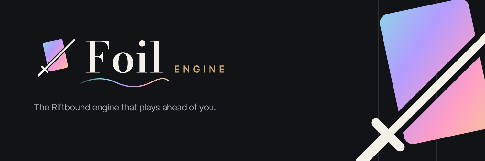

**Foil Engine** is a Riftbound simulator built on a real rules engine: it knows which plays are legal, resolves every effect, and plays against you.

- **A judge**: every Core Rules section implemented and tested, with a public coverage report.
- **An opponent**: an AI that plays full games and explains its moves.
- **A lab**: thousands of simulated games to measure a matchup and find a deck's weak spot.

## Repositories

| Repository | Contents |
| --- | --- |
| [foilengine](https://github.com/FoilEngine/foilengine) | The code: rules engine, cards, AI, server, clients, monitoring |
| [brand](https://github.com/FoilEngine/brand) | The identity: logos, motion, sound, design system |

Foil Engine is free and will stay free.

Foil was created under Riot Games' "Legal Jibber Jabber" policy using assets owned by Riot Games. Riot Games does not endorse or sponsor this project.
